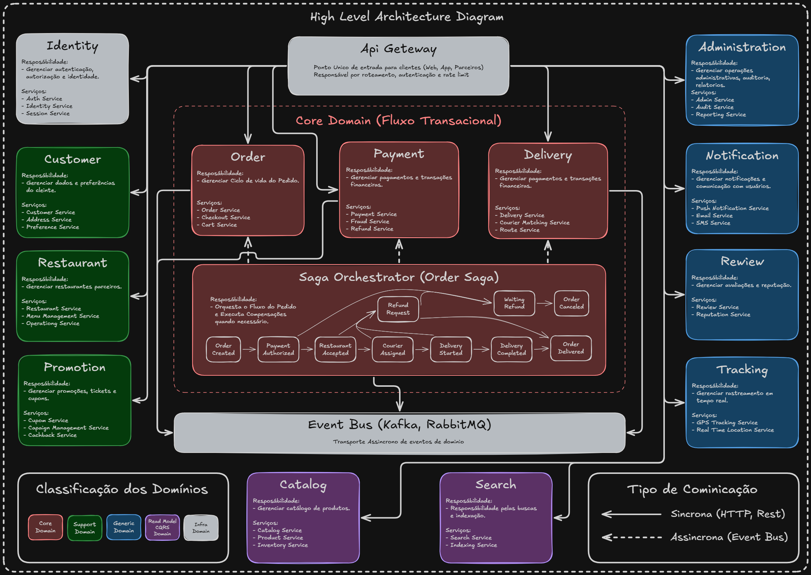

# Arquitetura Base

## Estilo Arquitetural

A aplicação será baseada em:

- Microservices
- Event-Driven Architecture
- Domain-Driven Design
- CQRS (parcial)
- Saga Pattern
- API Gateway

---

# Diagrama de Arquitetura de Alto Nível


# Context Map

## Bounded Contexts

O domínio será dividido nos seguintes bounded contexts:

1. Identity & Access
2. Customer
3. Restaurant
4. Catalog
5. Order
6. Payment
7. Delivery
8. Notification
9. Promotion
10. Review
11. Tracking
12. Administration
13. Billing
14. Search

---

# Bounded Context: Identity & Access

## Responsabilidade

Responsável por autenticação, autorização e identidade.

## Serviços

- Auth Service
- Identity Service
- Session Service

## Entidades

### User

- id
- email
- passwordHash
- status
- createdAt

### Role

- id
- name
- permissions

## Aggregates

### UserAggregate

Raiz:

- User

Entidades internas:

- Roles
- Sessions

## Value Objects

- Email
- Password
- Token

## Domain Events

- UserCreated
- UserAuthenticated
- UserBlocked

---

# Bounded Context: Customer

## Responsabilidade

Gerenciar dados e preferências do cliente.

## Serviços

- Customer Service
- Address Service
- Preference Service

## Entidades

### Customer

- id
- userId
- name
- phone
- rating

### Address

- id
- zipcode
- street
- city
- latitude
- longitude

## Aggregates

### CustomerAggregate

Raiz:

- Customer

Entidades internas:

- Address
- Preferences

## Value Objects

- PhoneNumber
- Coordinates

## Domain Events

- CustomerCreated
- AddressAdded

---

# Bounded Context: Restaurant

## Responsabilidade

Gerenciar restaurantes parceiros.

## Serviços

- Restaurant Service
- Menu Management Service
- Operating Hours Service

## Entidades

### Restaurant

- id
- name
- category
- status
- rating

### OperatingHours

- dayOfWeek
- openTime
- closeTime

## Aggregates

### RestaurantAggregate

Raiz:

- Restaurant

Entidades internas:

- OperatingHours
- DeliveryArea

## Value Objects

- CNPJ
- RestaurantStatus

## Domain Events

- RestaurantCreated
- RestaurantClosed
- RestaurantOpened

---

# Bounded Context: Catalog

## Responsabilidade

Gerenciar catálogo de produtos.

## Serviços

- Catalog Service
- Product Service
- Inventory Service

## Entidades

### Product

- id
- restaurantId
- name
- description
- price
- available

### Category

- id
- name

## Aggregates

### ProductAggregate

Raiz:

- Product

Entidades internas:

- Addons
- ProductImages

## Value Objects

- Money
- ProductDescription

## Domain Events

- ProductCreated
- ProductUpdated
- ProductOutOfStock

---

# Bounded Context: Order

## Responsabilidade

Gerenciar ciclo de vida do pedido.

## Serviços

- Order Service
- Checkout Service
- Cart Service

## Entidades

### Order

- id
- customerId
- restaurantId
- status
- total
- createdAt

### OrderItem

- productId
- quantity
- price

## Aggregates

### OrderAggregate

Raiz:

- Order

Entidades internas:

- OrderItems
- PaymentSnapshot
- DeliverySnapshot

## Value Objects

- OrderStatus
- OrderNumber
- Money

## Domain Services

- OrderPricingService
- DeliveryFeeCalculator

## Domain Events

- OrderCreated
- OrderConfirmed
- OrderCancelled
- OrderDelivered

## Regras de Negócio

- Pedido não pode ser confirmado sem pagamento aprovado
- Pedido não pode ser entregue sem entregador associado
- Pedido cancelado deve iniciar fluxo de estorno

---

# Bounded Context: Payment

## Responsabilidade

Gerenciar pagamentos e transações financeiras.

## Serviços

- Payment Service
- Fraud Service
- Refund Service

## Entidades

### Payment

- id
- orderId
- amount
- method
- status

### Transaction

- gatewayId
- authorizationCode

## Aggregates

### PaymentAggregate

Raiz:

- Payment

Entidades internas:

- Transactions
- Refunds

## Value Objects

- CardToken
- PixKey
- Currency

## Domain Events

- PaymentAuthorized
- PaymentRejected
- PaymentRefunded

---

# Bounded Context: Delivery

## Responsabilidade

Gerenciar entregadores e entregas.

## Serviços

- Delivery Service
- Courier Matching Service
- Route Service

## Entidades

### Courier

- id
- name
- vehicleType
- status
- currentLocation

### Delivery

- id
- orderId
- courierId
- status

## Aggregates

### DeliveryAggregate

Raiz:

- Delivery

Entidades internas:

- Route
- TrackingHistory

## Value Objects

- Coordinates
- VehicleType

## Domain Events

- CourierAssigned
- DeliveryStarted
- DeliveryCompleted

---

# Bounded Context: Promotion

## Responsabilidade

Gerenciar promoções e campanhas.

## Serviços

- Coupon Service
- Campaign Service
- Cashback Service

## Entidades

### Coupon

- id
- code
- discountType
- value
- expirationDate

## Aggregates

### PromotionAggregate

Raiz:

- Coupon

Entidades internas:

- Rules
- UsageHistory

## Value Objects

- Discount
- ExpirationDate

## Domain Events

- CouponCreated
- CouponExpired
- CouponUsed

---

# Bounded Context: Notification

## Responsabilidade

Gerenciar comunicação assíncrona com usuários.

## Serviços

- Push Notification Service
- Email Service
- SMS Service

## Entidades

### Notification

- id
- userId
- type
- payload
- status

## Aggregates

### NotificationAggregate

Raiz:

- Notification

## Domain Events

- NotificationSent
- NotificationFailed

---

# Bounded Context: Review

## Responsabilidade

Gerenciar avaliações.

## Serviços

- Review Service
- Reputation Service

## Entidades

### Review

- id
- orderId
- rating
- comment

## Aggregates

### ReviewAggregate

Raiz:

- Review

## Domain Events

- ReviewCreated
- ReputationUpdated

---

# Bounded Context: Tracking

## Responsabilidade

Gerenciar rastreamento em tempo real.

## Serviços

- GPS Tracking Service
- Realtime Location Service

## Entidades

### TrackingPosition

- courierId
- latitude
- longitude
- timestamp

## Domain Events

- CourierLocationUpdated

---

# Bounded Context: Search

## Responsabilidade

Responsável pelas buscas e indexação.

## Serviços

- Search Service
- Indexing Service

## Tecnologias Indicadas

- Elasticsearch
- OpenSearch

## Eventos Consumidos

- RestaurantCreated
- ProductUpdated
- ReviewCreated

---

# Bounded Context: Administration

## Responsabilidade

Gerenciar operações administrativas.

## Serviços

- Admin Service
- Audit Service
- Reporting Service

## Entidades

### AuditLog

- id
- action
- actor
- timestamp

---

# Comunicação Entre Contextos

## Comunicação Síncrona

Utilizada para:

- Consultas críticas
- Autenticação
- Validação imediata

Tecnologias:

- REST
- gRPC

---

## Comunicação Assíncrona

Utilizada para:

- Eventos de domínio
- Processamentos demorados
- Integração entre contextos

Tecnologias:

- Kafka
- RabbitMQ

---

# Eventos Principais do Sistema

## Fluxo de Pedido

1. OrderCreated
2. PaymentAuthorized
3. RestaurantAcceptedOrder
4. CourierAssigned
5. DeliveryStarted
6. DeliveryCompleted
7. OrderDelivered

---

# Saga Pattern

## Saga Orquestrada

Sugestão:

- Order Saga Orchestrator

Responsável por:

- Coordenar pagamento
- Coordenar entrega
- Coordenar cancelamentos
- Executar compensações

## Exemplos de Compensação

- Cancelar pagamento
- Liberar entregador
- Restaurar estoque
- Cancelar pedido

---

# CQRS

## Write Model

Responsável por:

- Regras de negócio
- Consistência
- Transações

## Read Model

Responsável por:

- Consultas otimizadas
- Dashboards
- Listagens
- Relatórios

---

# Estratégia de Banco de Dados

## Database per Service

Cada microserviço deve possuir:

- Banco isolado
- Schema isolado
- Independência de deploy

---

# Bancos Sugeridos

## PostgreSQL

Utilizado para:

- Pedidos
- Pagamentos
- Usuários
- Restaurantes

## Redis

Utilizado para:

- Cache
- Sessões
- Rate limiting
- Geolocalização temporária

## Elasticsearch

Utilizado para:

- Busca textual
- Geolocalização
- Ranking

## MongoDB

Utilizado para:

- Logs
- Eventos
- Tracking

---

# Segurança

## Estratégias

- OAuth2
- JWT
- API Gateway
- WAF
- Rate Limiting
- Criptografia AES
- Secrets Manager

---

# Observabilidade

## Logs

- Centralização com ELK
- Correlação por traceId

## Métricas

- Prometheus
- Grafana

## Tracing

- OpenTelemetry
- Jaeger

---

# Infraestrutura

## Cloud

Sugestão:

- AWS
- GCP
- Azure

## Componentes

- Kubernetes
- API Gateway
- Service Mesh
- Load Balancer
- CDN

---

# Estratégias de Escalabilidade

## Horizontal Scaling

Serviços devem:

- Ser stateless
- Utilizar cache distribuído
- Utilizar filas
- Utilizar particionamento

---

# Estratégias de Resiliência

## Padrões

- Circuit Breaker
- Retry
- Timeout
- Bulkhead
- Fallback

---

# Estrutura de Pastas Sugerida

```text
/src
  /contexts
    /order
      /application
      /domain
      /infrastructure
      /interfaces

    /payment
    /delivery
    /catalog
```

---

# Estrutura do Domínio

## Application Layer

Responsável por:

- Casos de uso
- Orquestração
- Transações

## Domain Layer

Responsável por:

- Entidades
- Aggregates
- Regras de negócio
- Domain services
- Eventos

## Infrastructure Layer

Responsável por:

- Banco de dados
- Mensageria
- APIs externas

## Interface Layer

Responsável por:

- Controllers
- DTOs
- APIs

---

# Considerações Finais

A arquitetura proposta foi desenhada visando:

- Escalabilidade
- Evolução independente dos domínios
- Alta disponibilidade
- Resiliência
- Manutenibilidade
- Separação clara de responsabilidades
- Baixo acoplamento
- Alta coesão

O uso de DDD combinado com arquitetura orientada a eventos permite que a plataforma evolua de maneira sustentável mesmo sob alto volume de usuários e pedidos simultâneos.